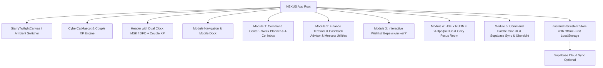

# NEXUS Couple Life OS // Elephant Architecture Specification (EGM_SPEC.md)

## 1. System Vision & Architecture
NEXUS is an ultra-modern personal operating system for **Egor** and **Anya**, built for cross-device life management in Moscow (MacBook Air M4, iPhone 15 Pro Max, Windows Laptop, Samsung A80).

## 2. Core Modules Specification

### Module 1: Command Center
- **Week Calendar**: 7 day columns (Mon–Sun) with today column glowing in warm amber (`rgba(245, 158, 11, 0.5)`). Full `@dnd-kit` drag-and-drop between Inbox and Days.
- **4-Column Inbox**:
  - Filter pills: `Все`, `Егор`, `Аня`, `Вместе 💕`, `🏠 Дом`, `🎓 ВШЭ & РУДН`, `🏆 Я-Профи`, `💼 Работа`.
  - Smart room grouping toggle (Room Hub cards vs flat 4-column screenshot grid).
  - Search and bracket color filters.

### Module 2: Finance Terminal & Cashback Advisor
- **Cashback Advisor**:
  - Cards matrix: Anya (Sber / SberPrime 5% supermarkets, 10% delivery), Egor (T-Bank 6% home/repairs, Alfa 5% cafes, WB Bank 7% discount on Wildberries, Gazprombank cashback claim).
  - Purchase advisor calculator: user inputs store/category, Cyber Cat Nexus gives real-time recommendation of the best card to pay with.
- **Moscow ЖКХ Tracker**:
  - Domiland (`1668.72 ₽ + 16.69 ₽ fee`), Mosenergosbyt (readings reminder 15–26th), EPD mos.ru (cap. repair & TKO), Wi-Fi (650 ₽).
  - SVG dynamic trend charts and Joint Fund pool calculator (deposits on 10th and 25th).

### Module 3: Wishlist «Берем или нет? 🐾»
- Questions from screenshot: «Тарелки плоские?», «Тарелки глубокие?», «Нож еще надо?», «Поварешки, лопатка?», «Стаканы?», «Подставка под ложки?», «Сушилка для посуды?», «Скатерть?», «Перестановка?».
- Two-player vote buttons (`💜 Берем!`, `🤔 Подумать`, `❌ Не надо`).
- Double `💜` match triggers shooting star / confetti animation, marks item as approved, computes total budget, and offers one-click conversion to home task.

### Module 4: «ВШЭ x РУДН x Я-Профессионал» & Cozy Focus Room
- **Dual Timezone Widget**: Moscow (MSK UTC+3) vs Vladivostok/Khabarovsk (DFO UTC+10, MSK+7) for Anya's calls as Federal Leader of DFO!
- **Academic & Career Kanban**:
  - Egor: HSE Master's degree (distributed consensus, research paper, exam session) + Software Dev (OpenMap, sprints).
  - Anya: RUDN Online (lectures, tests, clinical psychology coursework).
  - «Я-Профессионал» Leaders: DFO Federal Leadership, CFO Regional Leadership, Moscow events and forum dates.
- **Cozy Focus Room (`PLAY. FOCUS. WIN. REPEAT.` / `one more level. one step closer.`):**
  - Pomodoro timer with game-like sound chimes.
  - Built-in cozy audio synthesizer using Web Audio API: gentle night rain, warm fireplace brown noise, and harmonic chimes without any external audio files.
  - Cyber Cat Nexus in headphones animated to the beat!

### Module 5: Command Palette, PWA & Übersicht Widget
- `Cmd+K` NLP task parser (`"Созвон с ДФО завтра в 10:00 #япрофи @аня !важно"`).
- Supabase credentials setup + copyable SQL migration schema.
- TickTick CSV/JSON importer.
- `?mode=widget` for desktop transparency + `widgets/nexus-ubersicht.jsx`.
- GitHub Actions CI/CD to GitHub Pages.

---

## 3. Phase 2: Deep Interactive Engineering Specification (EGM Iteration 2)

```mermaid
graph TD
    Store[Zustand Store + LocalStorage + Supabase] --> Blueprint[Apartment Blueprint System]
    Store --> Telegram[Telegram Bot Client Bridge]
    Store --> Radar[RF Command Radar CFO <-> DFO]
    Store --> Academic[Academic Schedule & Grade Tracker]
    Store --> DateNight[Date Night Planner & 4 Nov Roulette]
    Store --> Sound[Web Audio Sound Effects Engine]
    Store --> Tamagotchi[Cyber-Cat Tamagotchi & Wardrobe]
    
    Blueprint --> Pins[Problem Pins: Герметик, Коробки, Фильтр, Люстра]
    Telegram --> PushOut[Push Out: Wishlist, Utilities, Task Done]
    Telegram --> SyncIn[Sync In: getUpdates + NLP Task Extraction]
    Radar --> HumaneCalls[Humane Call Times & Timezone Slider]
    Radar --> BroadcastGen[1-Click Telegram Announcement Generator]
    Academic --> IcsImport[.ics Parser for HSE RUZ & RUDN Online]
    Academic --> Formulas[HSE 10-pt & RUDN BRS 100-pt Calculators]
    DateNight --> Roulette[Slot Machine / Roulette Wheel]
    DateNight --> CardsAdvice[Best Cashback Card for Date]
    Sound --> Procedural[Pure AudioContext: Click, Success, Meteor, Purr, Eat]
```

### 3.1. Interactive Apartment Blueprint (`ApartmentBlueprint.tsx`)
- **Zones**: Bathroom, Balcony, Kitchen, Living Room, Hallway.
- **Dynamic Metrics**:
  - Live coziness / repair %: calculated dynamically from completed tasks in each room.
  - Active tasks & wishlist items badge per room.
- **Problem Pins (from screenshot)**:
  - Bathroom: `💧 Кабина: герметик`, `🚽 Кнопка унитаза`, `🪝 Клей. Крючок`.
  - Balcony: `📦 Коробки`, `🧱 Затирка`, `🪟 Помыть окна`.
  - Kitchen: `🚰 Фильтр`, `🔌 Заглушка над шкафом`, `🧼 Отмыть раковину`.
  - Living Room: `💡 Люстра`, `📏 Плинтус`, `🛋 Перестановка?`, `👔 Шкаф`.
- **Interactive Cat Relocation**: clicking any room triggers SVG coordinates interpolation for Cyber-Cat, illuminates room in warm amber (`#f59e0b`), and slides out room management drawer.

### 3.2. Direct Telegram Bot Client Bridge (`telegramBotService.ts` & `TelegramBridgeModal.tsx`)
- Direct client-side calls to `https://api.telegram.org/bot<token>/...` with zero backend.
- Token and chat IDs stored securely in local Zustand persist.
- Push templates:
  - Wishlist approved: item title, estimated price, card recommendation, link.
  - Utilities alert: Domiland status + Mosenergosbyt window alert.
  - Task completed celebration: partner notification with couple XP.
  - Mutual wishlist like celebration.
- Inbound sync:
  - `getUpdates(offset)` polling on demand.
  - NLP extraction for date, assignee, tags, bracket color.
  - Auto-injection into Inbox with celebration sound.

### 3.3. RF Command Radar ЦФО ⇄ ДФО (`YaProfiMapRadar.tsx`)
- Interactive vector map of Russia with glowing arcs connecting Moscow (CFO) and Far East hubs:
  - Moscow (UTC+3)
  - Vladivostok (UTC+10 / MSK+7)
  - Khabarovsk (UTC+10 / MSK+7)
  - Yakutsk (UTC+9 / MSK+6)
  - Petropavlovsk-Kamchatsky (UTC+12 / MSK+9)
  - Yuzhno-Sakhalinsk (UTC+11 / MSK+8)
- 24-hour MSK slider with color-coded humane calling zones:
  - Green (09:00 - 18:00 local): Humane call window.
  - Yellow (18:00 - 21:00 local): Evening call window.
  - Red (21:00 - 08:00 local): Sleep / Do not disturb.
- Announcement generator with automated timezone translation and 1-click clipboard copy.

### 3.4. Academic Tracker & `.ics` Schedule Importer (`icsParser.ts` & `AcademicTracker.tsx`)
- Client-side iCalendar parser (`BEGIN:VEVENT`, `SUMMARY`, `DTSTART`, `DTEND`, `DESCRIPTION`, `LOCATION`).
- Automatic conversion to `NexusTask` with HSE or RUDN categories.
- Grade calculators:
  - HSE 10-point scale: $O_{итог} = \sum w_i O_i$ with official HSE rounding conventions.
  - RUDN BRS 100-point scale: current control, milestone control, exams, ECTS conversion (A = 95-100, B = 86-94, C = 69-85, D = 61-68, E = 51-60).

### 3.5. Date Night & Weekend Generator «Что делаем 4 ноября? 💕» (`DateNightPlanner.tsx`)
- Neon slot machine / roulette date generator with sound effects.
- 20+ rich Moscow & cozy home date scenarios tailored for Egor & Anya.
- Filters for Vibe, Budget, and Duration.
- Card cashback advisor recommendation for maximum bonus points.
- 1-click auto-schedule for November 4 (National Unity Day).

### 3.6. Tamagotchi Mascot & Web Audio UI Sound Engine (`soundEffects.ts` & `CyberCatMascot.tsx`)
- Pure procedural Web Audio API sounds: `playClick`, `playSuccess`, `playMeteor`, `playLevelUp`, `playPurr`, `playEat`, `playAlert`.
- Wardrobe items: HSE Glasses, Razer Purple Cat Headphones, Leader Crown, Winter Scarf, Cyber Wings.
- Feeding mechanics: treats earned from completed chores, hunger level management, purr animations.
