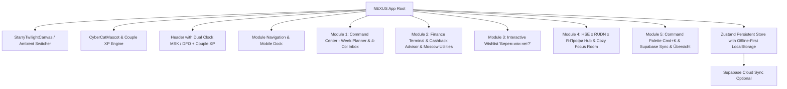

# NEXUS Couple Life OS // Elephant Architecture Specification (EGM_SPEC.md)

## 1. System Vision & Architecture
NEXUS is an ultra-modern personal operating system for **Egor** and **Anya**, built for cross-device life management in Moscow (MacBook Air M4, iPhone 15 Pro Max, Windows Laptop, Samsung A80).

## 2. Core Modules Specification

### Module 1: Command Center
- **Week Calendar**: 7 day columns (Mon–Sun) with today column glowing in warm amber (`rgba(245, 158, 11, 0.5)`). Full `@dnd-kit` drag-and-drop between Inbox and Days.
- **4-Column Inbox**:
  - Filter pills: `Все`, `Егор`, `Аня`, `Вместе 💕`, `🏠 Дом`, `🎓 ВШЭ & РУДН`, `🏆 Я-Профи`, `💼 Работа`.
  - Smart room grouping toggle (Room Hub cards vs flat 4-column screenshot grid).
  - Search and bracket color filters.

### Module 2: Finance Terminal & Cashback Advisor
- **Cashback Advisor**:
  - Cards matrix: Anya (Sber / SberPrime 5% supermarkets, 10% delivery), Egor (T-Bank 6% home/repairs, Alfa 5% cafes, WB Bank 7% discount on Wildberries, Gazprombank cashback claim).
  - Purchase advisor calculator: user inputs store/category, Cyber Cat Nexus gives real-time recommendation of the best card to pay with.
- **Moscow ЖКХ Tracker**:
  - Domiland (`1668.72 ₽ + 16.69 ₽ fee`), Mosenergosbyt (readings reminder 15–26th), EPD mos.ru (cap. repair & TKO), Wi-Fi (650 ₽).
  - SVG dynamic trend charts and Joint Fund pool calculator (deposits on 10th and 25th).

### Module 3: Wishlist «Берем или нет? 🐾»
- Questions from screenshot: «Тарелки плоские?», «Тарелки глубокие?», «Нож еще надо?», «Поварешки, лопатка?», «Стаканы?», «Подставка под ложки?», «Сушилка для посуды?», «Скатерть?», «Перестановка?».
- Two-player vote buttons (`💜 Берем!`, `🤔 Подумать`, `❌ Не надо`).
- Double `💜` match triggers shooting star / confetti animation, marks item as approved, computes total budget, and offers one-click conversion to home task.

### Module 4: «ВШЭ x РУДН x Я-Профессионал» & Cozy Focus Room
- **Dual Timezone Widget**: Moscow (MSK UTC+3) vs Vladivostok/Khabarovsk (DFO UTC+10, MSK+7) for Anya's calls as Federal Leader of DFO!
- **Academic & Career Kanban**:
  - Egor: HSE Master's degree (distributed consensus, research paper, exam session) + Software Dev (OpenMap, sprints).
  - Anya: RUDN Online (lectures, tests, clinical psychology coursework).
  - «Я-Профессионал» Leaders: DFO Federal Leadership, CFO Regional Leadership, Moscow events and forum dates.
- **Cozy Focus Room (`PLAY. FOCUS. WIN. REPEAT.` / `one more level. one step closer.`):**
  - Pomodoro timer with game-like sound chimes.
  - Built-in cozy audio synthesizer using Web Audio API: gentle night rain, warm fireplace brown noise, and harmonic chimes without any external audio files.
  - Cyber Cat Nexus in headphones animated to the beat!

### Module 5: Command Palette, PWA & Übersicht Widget
- `Cmd+K` NLP task parser (`"Созвон с ДФО завтра в 10:00 #япрофи @аня !важно"`).
- Supabase credentials setup + copyable SQL migration schema.
- TickTick CSV/JSON importer.
- `?mode=widget` for desktop transparency + `widgets/nexus-ubersicht.jsx`.
- GitHub Actions CI/CD to GitHub Pages.
